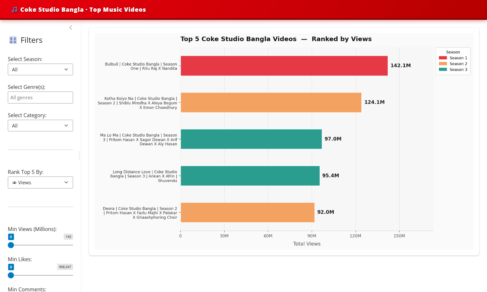

# 🎵 Coke Studio Bangla — YouTube Dataset & Dashboard

An end-to-end data project that tracks every video on the **Coke Studio Bangla** YouTube channel. A Python pipeline pulls fresh metrics from the YouTube Data API v3, publishes them as a **daily-updated Kaggle dataset**, and an interactive **Python Shiny dashboard** ranks the top videos.

**🔴 [Live Dashboard](https://sarandnath.shinyapps.io/coke-studio-bangla-day10-v2/)** &nbsp;·&nbsp;
**📊 [Kaggle Dataset](https://www.kaggle.com/datasets/sarandebnath/coke-studio-bangla-youtube-metric-daily-update)**



---

## How it works

```
YouTube Data API v3 ──► data_pipeline/ ──► Kaggle Dataset ──► dashboard/app.py ──► shinyapps.io
  (all channel videos)   (runs daily        (CSV, versioned)    (downloads latest     (public web app)
                          on Kaggle)                              data on start-up)
```

1. **Collect** – the pipeline pages through the channel's uploads playlist and fetches statistics, metadata and descriptions in batches of 50.
2. **Enrich** – each video is classified (type, season, genre) and credits are parsed (lead vocals, director, Spotify link). Titles are translated to English.
3. **Publish** – the script runs as a Kaggle notebook and saves a new dataset version.
4. **Visualise** – the Shiny app downloads the latest dataset version with `kagglehub` when it starts.

## 📦 Use the dataset (no setup required)

```python
import kagglehub

path = kagglehub.dataset_download("sarandebnath/coke-studio-bangla-youtube-metric-daily-update")
print("Path to dataset files:", path)
```

## Dashboard features

- **Top 5 ranking** by Views, Likes or Comments
- **Filters:** Season, Genre (multi-select), Category (e.g. *Official Music Video*), and minimum Views / Likes / Comments
- Season colour-coding (supports up to 10 seasons) with a legend that never overlaps the bars
- Videos that share the same title are kept on separate rows and labelled with their type

## Dataset columns

| Column | Description |
|---|---|
| `Video_ID`, `Video_URL` | YouTube identifier and link |
| `Title`, `English_Title` | Original title (Bengali / English) and its English translation |
| `Published_At`, `Video_Duration` | Upload date (`YYYY-MM-DD`) and length (`MM:SS` or `HH:MM:SS`) |
| `Views`, `Likes`, `Comments` | Engagement metrics at time of collection |
| `Video_Type` | Official Music Video, Shorts, Reels, Behind the Scenes, Celebration / Milestone, Live Event, Promo / Teaser, Uncategorized |
| `Season` | Season 1 – 10 (or Uncategorized) |
| `Genre` | One or more of Folk, Fusion, Classical, Rock, Pop, Qawwali, Jazz, Latin, Hip-Hop, Afrobeat, R&B / Soul (music videos only) |
| `Lead_Vocals` | Lead singers parsed from the description (backing vocals excluded) |
| `Director`, `Spotify_Link` | Parsed from the video description |
| `Thumbnail_URL` | Highest-resolution thumbnail available |
| `Last_Updated`, `Video_Details` | Collection timestamp and full description |

## Data-quality challenges solved

Classifying videos from free-text titles and descriptions caused some subtle bugs. Fixing them is a large part of this project:

| Problem | Example | Fix |
|---|---|---|
| Keywords matched **inside credits** | A music video was tagged *Reels* because its credits read "VIDEO PRODUCTION: INDIE **REELS**" | Plain words only count in the title; hashtags (`#Reels`) count anywhere |
| Genre keywords matched **inside names and other words** | Every song was tagged *Folk* ("Mehedi Hasan An**sari**") and *Hip-Hop* ("Director of Photog**rap**hy") | Whole-word regex (`\b…\b`) and genre search restricted to the song's story paragraphs, not the credits list |
| Wrong **director** extracted | "Assoc Creative Director:" matched before "Director:" | Match only lines that *start* with `Director:` and stop at the line end |
| **Duplicate titles** overlapped in the chart | A 16-second clip and the full 69M-view video share one title | Plot on numeric positions and label duplicates with their video type |
| Untagged **short clips** counted as songs | 16-second to 1-minute snippets | Videos ≤ 90 s are classified as Shorts (shortest real music video is ~3:48) |

## Project structure

```
├── data_pipeline/
│   ├── coke_studio_bangla_dataset.py   # YouTube API → enriched CSV
│   └── requirements.txt
├── dashboard/
│   ├── app.py                          # Python Shiny app
│   ├── styles.css
│   └── requirements.txt
├── docs/
│   └── kaggle_dataset_description.md
├── images/
│   └── dashboard.png
└── LICENSE
```

## ⚙️ Run the data pipeline yourself

The same script runs **on Kaggle** (reads the key from Kaggle Secrets) or **on your computer** (reads it from a `.env` file).

Get a free YouTube Data API v3 key from the [Google Cloud Console](https://console.cloud.google.com/).

**On your computer**

```powershell
git clone https://github.com/saranDnath/coke-studio-bangla-dataset.git
cd coke-studio-bangla-dataset/data_pipeline
python -m venv .venv
.\.venv\Scripts\activate          # macOS/Linux: source .venv/bin/activate
pip install -r requirements.txt
```

Create a `.env` file in `data_pipeline/` (it is git-ignored, so it is never pushed):

```
YOUTUBE_API_KEY=your_youtube_api_key_here
```

```powershell
python coke_studio_bangla_dataset.py
```

The output is saved as `coke_studio_bangla_raw.csv`.

**On Kaggle**

Paste the script into a notebook, add your key under *Add-ons → Secrets* as `YOUTUBE_API_KEY`, and run it. Missing packages are installed automatically.

## 📊 Run the dashboard locally

```powershell
cd dashboard
python -m venv .venv
.\.venv\Scripts\activate
pip install -r requirements.txt
shiny run --reload app.py
```

Open http://127.0.0.1:8000. The app downloads the latest dataset from Kaggle automatically. No API key is needed.

**Deploy to shinyapps.io**

```powershell
pip install rsconnect-python
rsconnect add --account <account> --name <account> --token <token> --secret <secret>
rsconnect deploy shiny dashboard --name <account> --title coke-studio-bangla
```

## Tech stack

Python · pandas · Matplotlib · Shiny for Python · YouTube Data API v3 · Kaggle · kagglehub · shinyapps.io

## License & data

Code is released under the [MIT License](LICENSE).
Video metadata and statistics come from the public YouTube Data API. All music, videos and trademarks belong to Coke Studio Bangla and their respective owners. This is an independent analytics project and is not affiliated with The Coca-Cola Company.

---

Made by [saranDnath](https://github.com/saranDnath) · [Kaggle](https://www.kaggle.com/sarandebnath)
